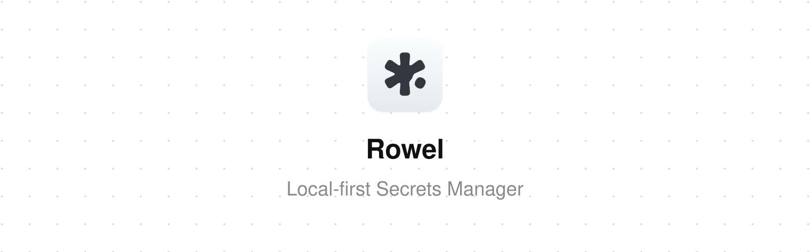

<div align="center">

**Keep every password, passkey, card, ID, SSH key, `.env` file and more in one encrypted vault on your own devices. No account, no server, no subscription.**

[](https://github.com/fwdai/rowel/actions)
[](https://github.com/fwdai/rowel/releases)
[](https://github.com/fwdai/rowel/releases)
[](LICENSE)

</div>


<div align="center">
Free and open source, because basic personal security should be. Runs on macOS, Windows, Linux and iOS. Sync is optional and goes through your own cloud, which only ever stores ciphertext.

[rowel.app](https://rowel.app) · [Threat model](docs/threat-model.md) · [Browser extension](docs/browser-extension.md) · [Security policy](SECURITY.md)

</div>

## Install

Download it directly — every link gives you the newest release:

| Platform          | Download                                                                                                                                                                                                                                                       |
| ----------------- | -------------------------------------------------------------------------------------------------------------------------------------------------------------------------------------------------------------------------------------------------------------- |
| macOS (Universal) | [.dmg](https://github.com/fwdai/rowel/releases/latest/download/Rowel_universal.dmg)                                                                                                                                                                            |
| Windows (x64)     | [setup .exe](https://github.com/fwdai/rowel/releases/latest/download/Rowel_x64-setup.exe)                                                                                                                                                                      |
| Linux (x86_64)    | [.deb](https://github.com/fwdai/rowel/releases/latest/download/Rowel_amd64.deb) · [.rpm](https://github.com/fwdai/rowel/releases/latest/download/Rowel_x86_64.rpm) · [.AppImage](https://github.com/fwdai/rowel/releases/latest/download/Rowel_amd64.AppImage) |
| iOS               | [TestFlight beta](https://testflight.apple.com/join/5dmNyYsP)                                                                                                                                                                                                  |

These names have no version in them, so they always resolve to the newest
release — from the next release onwards. Until that one is out, take the
versioned installer from the [releases page](https://github.com/fwdai/rowel/releases/latest);
it stays there alongside the version-free copy either way. iOS has no file to
download: it comes from Apple, through TestFlight for as long as it is in beta.

or install with the [GitHub CLI](https://cli.github.com), grab the latest installer for your OS:

```bash
gh release download --repo fwdai/rowel --pattern 'Rowel_universal.dmg'   # macOS; use Rowel_x64-setup.exe (Windows), Rowel_amd64.deb, Rowel_x86_64.rpm or Rowel_amd64.AppImage (Linux)
```

On desktop, Rowel updates itself after that, and it only installs updates whose signature checks out.

## Get started

1. **Open Rowel** and choose **Start fresh**. If you already use Rowel on another device, pick **Continue with a cloud account** instead. On desktop you can also choose **Restore from a backup file** (`.rowel`).
2. **Choose a master password** and type it a second time. On supported devices you can then turn on Touch ID, Face ID or Windows Hello.
3. **Bring your items in:** go to Settings → Import and drop in an export from your old password manager or browser. Or add your first login, card or SSH key by hand.
4. **Optional:** connect Google Drive or Dropbox in Settings to keep your devices in sync. iCloud is offered too on iPhone, and on Mac builds whose signature carries Apple's iCloud entitlement.

## Why I'm building this

I believe basic personal security should be available to everyone, for free. Nobody should have to pay a monthly subscription just to keep their passwords and secrets encrypted and safe.

So Rowel is free and open source for personal and family use, and it will stay that way. No trial, no locked "premium" vault, no account.

Down the road there may be a paid option for professional teams that need extra features. That's how the project can keep going, and it will never take anything away from the free app.

- Alex

## Why Rowel

1. **No account, no backend.** Your vault is encrypted files on your own disk, and it works fully offline. There's nothing to sign up for and no server that could be breached.
2. **Built for developers.** SSH keys (with fingerprint randomart, and Ed25519 keys generated in the app), API keys with environment and scopes, and whole `.env` files are their own item types, not notes you've pasted in.
3. **Switch in a few clicks.** Move in from 1Password, LastPass, Bitwarden, KeePass (CSV export), Enpass, Chrome, Safari or any FIDO CXF export. Point Rowel at your export and it brings your items over, with a report for anything it couldn't import.
4. **Bring your own cloud.** Each lockbox syncs to your Google Drive, Dropbox or iCloud as one encrypted file, and Rowel can only reach its own app-scoped storage there. Edits from different devices merge item by item on their own: there are no conflict dialogs, and when two devices change the same item, the newer edit wins.
5. **Encrypted even while open.** The vault is encrypted on disk, and each item is sealed a second time inside it. The list and search work without unsealing anything, and the app's interface gets an item's secrets only when you open that item.
6. **Lockboxes.** One vault, one master password, divided into lockboxes such as Personal, Work or Clients. Each lockbox is kept in its own encrypted file and can sync to its own cloud account.
7. **Private sharing by link.** Share one item through an encrypted link that expires in 24 hours and can be revoked. The key lives only in the link. Sharing works from a lockbox synced to Google Drive, and the recipient opens the link in Rowel.
8. **Scan to fill.** Take a photo of a card or passport and Rowel reads it on your device to fill in the fields. Nothing gets uploaded. Available on macOS, Windows and iOS.
9. **Releases you can verify.** Every installer comes with proof of how it was built, the macOS app is signed and notarized, and updates install only if their signature checks out. Windows and Linux installers aren't code-signed yet, so check those with their build provenance. See [Verifying a release](#verifying-a-release).


### And all the essentials

- Logins, credit cards, identities and documents, secure notes, and file attachments
- Passkeys and TOTP codes, plus a password and passphrase generator
- Vault Health: strength scoring, reused-password checks, and an optional private breach check that never sends your password
- Browser autofill and passkeys for Chrome, Edge, Brave, Vivaldi and Firefox, plus Safari on macOS ([details](docs/browser-extension.md)). Passkeys are on by default from extension 0.1.1; an earlier install turns them on in the extension's options
- iOS AutoFill for passwords and passkeys, unlocked with Face ID (passkeys need iOS 17 or later)
- Touch ID, Face ID or Windows Hello unlock
- Locks itself when you're inactive and clears copied secrets from the clipboard
- Export to CSV, FIDO CXF, or Bitwarden-compatible JSON, plus encrypted backups
- Move to a new device by signing in to your cloud account, or on desktop by restoring a backup file
- Master-password changes are crash-safe, and an interrupted one rolls back
- Auto-updates on desktop, 10 languages, command palette

## How it works & security

Your vault is everything your master password opens. Each lockbox in it is an encrypted SQLite database (SQLCipher) on your own device, and each item is sealed again inside it in an application-level AEAD layer. No backend holds your secrets. All cryptography lives in the Rust core, and the app's UI never sees your master key. Sync uploads each lockbox to your cloud as one encrypted file. The terms the code uses are in [docs/development.md](docs/development.md#vocabulary).

- [`docs/threat-model.md`](docs/threat-model.md): what Rowel defends against, and what it doesn't
- [`SECURITY.md`](SECURITY.md): how to report a vulnerability
- [`docs/browser-extension.md`](docs/browser-extension.md) and [`docs/safari-extension.md`](docs/safari-extension.md): browser autofill

## Verifying a release

Every release is built in GitHub Actions and ships with supply-chain evidence:

- **SLSA build provenance** — each installer is attested with
  [`actions/attest-build-provenance`](https://github.com/actions/attest-build-provenance)
  (keyless OIDC signing). You can prove an installer was built by this repo's
  workflow, from this source, with the [GitHub CLI](https://cli.github.com):

  ```bash
  gh attestation verify ./Rowel_amd64.AppImage --repo fwdai/rowel
  ```

  (works for the `.dmg`, `-setup.exe`, `.deb`, `.rpm` and `.AppImage`
  assets — point it at whichever you downloaded, versioned name or not: the
  version-free copies are the same bytes and are attested as well).

  Releases up to and including `v1.0.0-alpha.6` were built before the project
  moved from `swiftyapp/swifty` to `fwdai/rowel`, so their provenance names the
  old repository. Verify those with `--repo swiftyapp/swifty` instead.

- **CycloneDX SBOM** — every release attaches `rowel-rust.cdx.json` (the full
  Rust dependency graph) and, when available, `rowel-js.cdx.json` (the
  frontend). Feed them to any CycloneDX-aware scanner (e.g. `grype sbom:./rowel-rust.cdx.json`)
  to audit the exact dependencies a build shipped.

- **Update signature** — the auto-updater only installs updates signed with the
  project's minisign key (public key in `src-tauri/tauri.conf.json`); the
  matching private key is never in this repository.

The Rust toolchain (`rust-toolchain.toml`) and the bun version are both pinned,
so every release is built with the same toolchain.

## Building from source

Rowel is a [Tauri 2](https://v2.tauri.app) app with a Rust core and a React + TypeScript frontend. For a quick start:

```bash
git clone https://github.com/fwdai/rowel.git && cd rowel
bun install && bun run tauri:dev
```

Everything else, including prerequisites, tests, the iOS AutoFill build, the Google OAuth setup for your own builds, update signing, and how to extend Rowel, is in [docs/development.md](docs/development.md).

## Contributing

Contributions are welcome. Read [CONTRIBUTING.md](CONTRIBUTING.md) and the [Code of Conduct](CODE_OF_CONDUCT.md) first, and report security issues privately as described in [SECURITY.md](SECURITY.md).

<a href="https://github.com/fwdai/rowel/graphs/contributors"></a>

## Support

❤️ it? Then ⭐️ it on GitHub or tell a friend. You can also support development:

[](https://www.paypal.me/alchaplinsky)
[](https://opencollective.com/rowelapp)

**Individuals**

<a href="https://opencollective.com/rowelapp"></a>

**Organizations** (your logo shows up here with a link to your website. [Contribute](https://opencollective.com/rowelapp/contribute))

<a href="https://opencollective.com/rowelapp/organization/0/website"></a>
<a href="https://opencollective.com/rowelapp/organization/1/website"></a>
<a href="https://opencollective.com/rowelapp/organization/2/website"></a>
<a href="https://opencollective.com/rowelapp/organization/3/website"></a>
<a href="https://opencollective.com/rowelapp/organization/4/website"></a>
<a href="https://opencollective.com/rowelapp/organization/5/website"></a>
<a href="https://opencollective.com/rowelapp/organization/6/website"></a>
<a href="https://opencollective.com/rowelapp/organization/7/website"></a>
<a href="https://opencollective.com/rowelapp/organization/8/website"></a>
<a href="https://opencollective.com/rowelapp/organization/9/website"></a>

## License

The apps are free software under the [GNU General Public License v3.0](LICENSE):
the desktop and iOS apps (`src/`, `src-tauri/src/`), the browser extension
(`extension/`, a fork of the GPL KeePassXC-Browser) and everything else in this
repository not listed below.

The Rust library crates under `src-tauri/crates/` (`rowel-core`,
`rowel-broker`, `rowel-autofill`) are licensed under
either the [MIT License](src-tauri/crates/core/LICENSE-MIT) or the
[Apache License, Version 2.0](src-tauri/crates/core/LICENSE-APACHE), at your
option, so that any program can link them. Each crate carries both license
files and names them in its `Cargo.toml`.

Contributions are accepted under the license of the part they touch, with a
Developer Certificate of Origin sign-off (see [CONTRIBUTING.md](CONTRIBUTING.md)).
